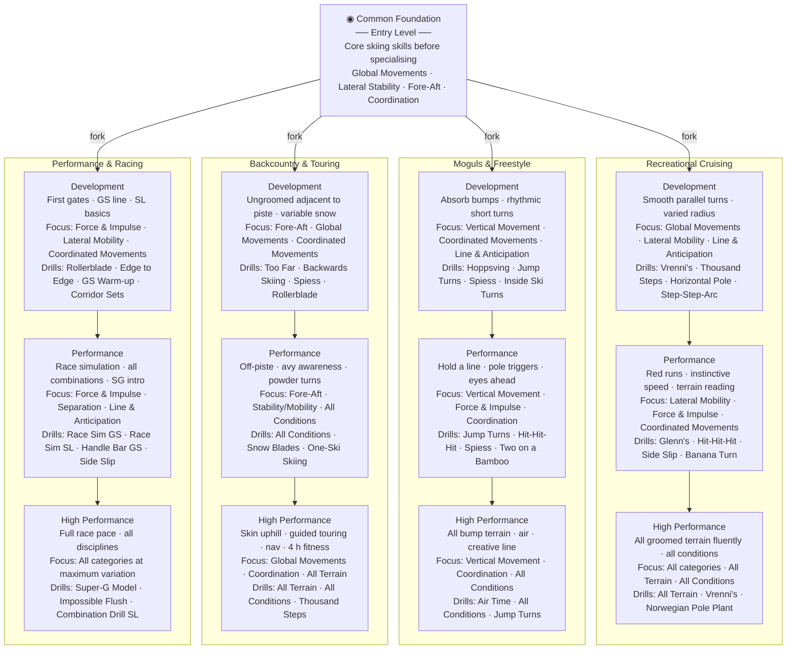

# Training Roadmap

## Level key

| Level | Description |
|---|---|
| Entry | Core foundational movement patterns on snow — applies to all four domains before specialising |
| Development | First steps within a chosen domain — technique building with guided drill progressions |
| Performance | Confident execution in domain-specific terrain and conditions — competition or touring ready |
| High Performance | Full mastery across all terrain and conditions within the domain at maximum variation |

## Key drills by domain and level

| Domain | Development | Performance | High Performance |
|---|---|---|---|
| Recreational Cruising | Vrenni's · Thousand Steps · Step-Step-Arc | Glenn's · Hit-Hit-Hit · Banana Turn | All Terrain · Vrenni's · Norwegian Pole Plant |
| Moguls & Freestyle | Hoppsving · Jump Turns · Inside Ski Turns | Jump Turns · Hit-Hit-Hit · Two on a Bamboo | Air Time · All Conditions · Jump Turns |
| Backcountry & Touring | Too Far · Backwards Skiing · Rollerblade | All Conditions · Snow Blades · One-Ski Skiing | All Terrain · All Conditions · Thousand Steps |
| Performance & Racing | Rollerblade · Edge to Edge · Corridor Sets | Race Sim GS · Handle Bar GS · Side Slip | Super-G Model · Impossible Flush · Combination Drill SL |
